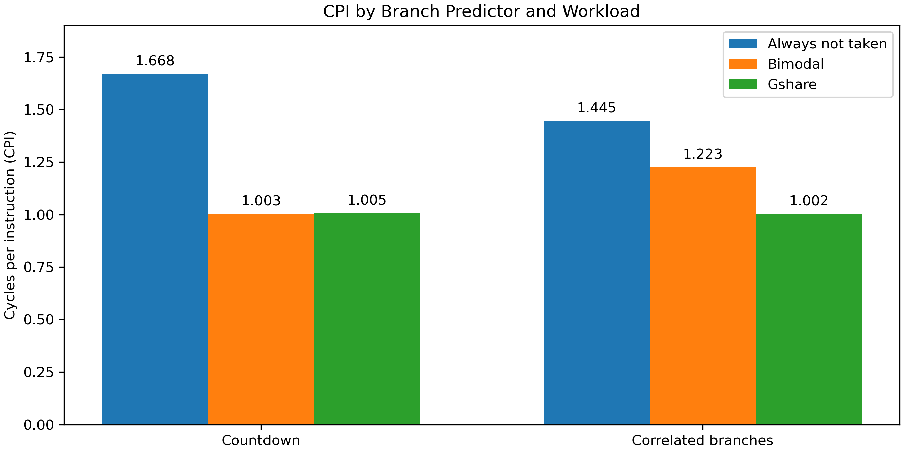

# Simple RISC-V Pipeline Simulator

A five-stage RISC-V pipeline simulator written in C++20.

- **Instructions:** Supports six RV32I instructions: `ADD`, `SUB`, `ADDI`, `LW`, `SW`, and `BEQ`.
- **Pipeline behavior:** Models forwarding, load-use stalls, and recovery after a wrong branch prediction.
- **Branch predictors:** Compares always-not-taken, 2-bit bimodal, and gshare.
- **Measurements:** Reports simulated cycles, branch mispredictions, and cycles per instruction (CPI).

## Build and run

Requirements: CMake 4.3 or newer and a C++20 compiler.

From the project root:

```bash
cmake -S . -B build -DCMAKE_BUILD_TYPE=Debug
cmake --build build
./build/pipeline_simulator
```

The executable runs the correctness tests and prints the benchmark results. Use a Debug build so the test assertions are enabled.

## Benchmark results

Each predictor runs the same program and input for each 1,000-iteration benchmark.

- **Countdown loop:** Counts down to zero and takes the backward branch on every iteration except the last.
- **Correlated-branch loop:** Two branches test the same alternating flag, so they both jump or both fall through on each iteration.
- **CPI:** Simulated cycles divided by the number of instructions that completed the pipeline.

| Predictor | Countdown CPI | Correlated-branch CPI |
| --- | ---: | ---: |
| Always not taken | 1.668 | 1.445 |
| 2-bit bimodal | **1.003** | 1.223 |
| Gshare | 1.005 | **1.002** |

Bimodal and gshare finished only 8 cycles apart on the countdown. On the correlated workload, gshare reduced mispredictions from 1,002 to 8 and used **18.1% fewer cycles** than bimodal.



The [raw results CSV](benchmarks/results.csv) records cycles, retired instructions, and mispredictions for all six runs. To regenerate the PNG and PDF from the recorded data, run this from the project root with Matplotlib installed:

```bash
python3 benchmarks/plot_cpi.py
```

## Code map and scope

- `Memory` and `RegisterFile` model the architectural state, including byte-addressable memory and the hardwired zero register.
- `Instruction` and `Decoder` translate 32-bit instruction words into operations, register indices, and signed immediates.
- `SequentialCpu::step()` executes one instruction at a time and provides a correctness reference. `PipelineCpu::tick()` advances all five stages by one simulated cycle and records a trace and performance counters.
- `BranchPredictor.h` defines the shared predictor interface and the prediction strategies used in the benchmarks.

The simulator implements six RV32I instructions and uses fixed memory timing. The results describe two synthetic workloads and the predictor configurations tested.